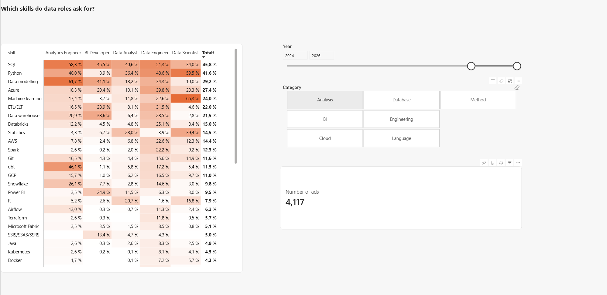
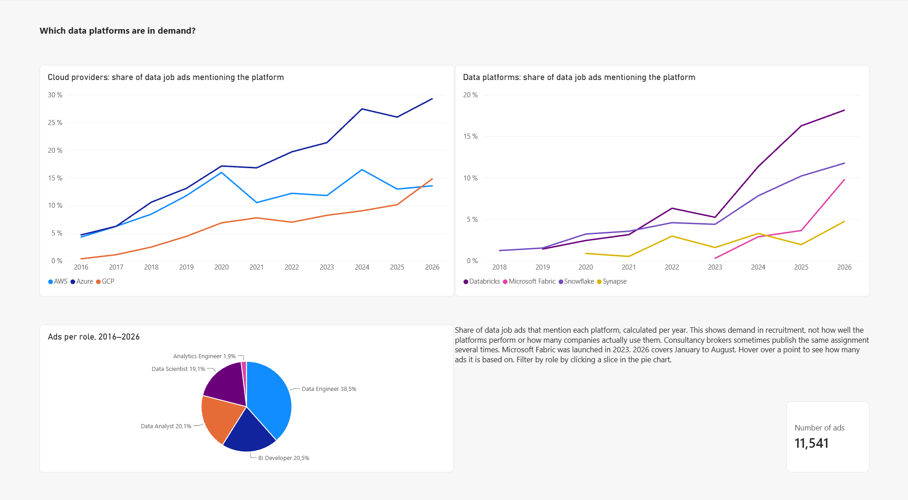
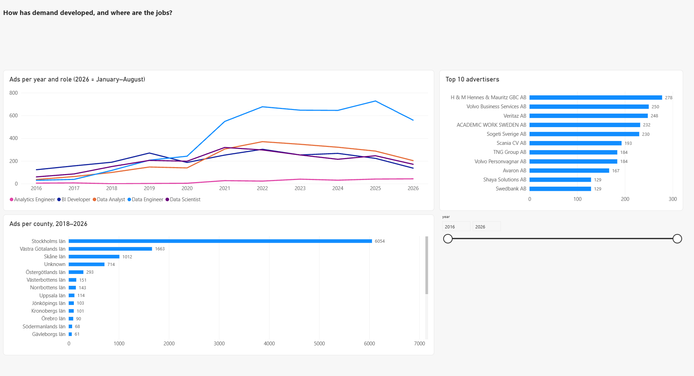
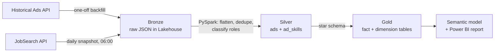

# platsbanken-data-jobs

**What skills does the Swedish job market ask for in data roles, and how has that changed over time?**

An end-to-end data engineering project that ingests job ads from Platsbanken (the Swedish Public Employment Service's job board), classifies them into data roles, extracts requested skills from the ad text, and serves the result as a Power BI report. Built in Microsoft Fabric.

> **Status:** Bronze, silver, gold, the Power BI report and a scheduled daily pipeline are done. The pipeline has run every morning since 2026-11-05 without a failure.

## Questions

1. How has demand for data engineers, data scientists, data analysts and BI developers developed since 2016?
2. Which tools and skills (SQL, Python, Power BI, Azure, Fabric, SAS, Spark …) are requested for each role, and how do the roles differ?
3. Where in Sweden are the jobs?

## Results

### Which skills do data roles ask for? (2024–2026, 4,117 ads)

- **SQL is the one skill every role shares**, mentioned in 34–58% of ads in all five roles.
- **Each role has a clear profile.** Data Scientist: machine learning (65%), Python (60%), statistics (39%). Data Engineer: SQL and Python (~50%), Azure (40%), ETL (32%), Databricks (25%). Analytics Engineer: data modelling (62%), dbt (46%), Snowflake (26%). BI Developer: data warehouse (39%), ETL (29%), Power BI (25%). Data Analyst: SQL (41%), Python (36%), statistics (28%), R (21%).

### Which data platforms are in demand? (2016–2026)

- **Azure dominates and keeps growing**, from 5% of data job ads in 2016 to 29% in 2026. AWS has been flat at 12–16% since 2020; GCP has grown slowly to about 15%.
- **Databricks is the leading data platform**, from almost nothing in 2019 to 18% of ads in 2026. Snowflake has grown more steadily to about 12%.
- **Microsoft Fabric is the fastest riser**, from under 1% in 2023 to 10% in 2026, overtaking Microsoft's previous platform Synapse.

### How has demand developed, and where are the jobs?

- **Data Engineer is by far the largest and fastest-growing role**, from 30 ads in 2016 to over 700 in 2025. Data Analyst ads peaked in 2022 and have declined since.
- **Stockholm County accounts for over half of all ads** with a known location (2018–2026).
- **Consultancies and staffing firms are among the largest advertisers**, alongside large employers such as H&M, Volvo and Scania.

### Caveats

These figures describe what job ads *say*, not what jobs require or which platforms companies actually use. Platsbanken does not cover the whole market; many tech roles are advertised only on LinkedIn or company sites. Shares are computed within each role and year, because the role mix changed a lot over the period. 2026 covers January–August.

## Data sources

All data comes from [JobTech Development](https://jobtechdev.se), Arbetsförmedlingen's open data platform.

| Source | Used for |
|---|---|
| **Historical Ads API** | One-off backfill of all ads for the selected roles, 2016–August 2026 |
| **JobSearch API** | Daily snapshot of all currently open ads for the same search terms |

## Architecture

| Layer | Notebook | Output |
|---|---|---|
| Bronze | [`nb_01_bronze_historical`](fabric/nb_01_bronze_historical.ipynb) | 896 raw JSON files (7 search terms × 128 months), 16,458 ad rows |
| Bronze | [`nb_05_bronze_daily`](fabric/nb_05_bronze_daily.ipynb) | One snapshot per day of all open ads (~200 ad rows) |
| Silver | [`nb_02_silver_ads`](fabric/nb_02_silver_ads.ipynb) | `ads`: deduplicated ads from both sources, classified into five roles (11,673 after the first snapshot) |
| Silver | [`nb_03_silver_skills`](fabric/nb_03_silver_skills.ipynb) | `ad_skills`: one row per ad and skill, 46 skills |
| Gold | [`nb_04_gold_star_schema`](fabric/nb_04_gold_star_schema.ipynb) | Star schema: `fact_ad`, bridge `fact_ad_skill`, five dimensions |
| Semantic model | [`semantic_model.md`](fabric/semantic_model.md) | Relationships and DAX measures |
| Orchestration | [`pl_daily_refresh.json`](fabric/pl_daily_refresh.json) | Fabric pipeline running bronze → silver → gold every day at 06:00 |

Each notebook starts with design notes explaining its decisions, and ends with checks that fail the run if the output is wrong. In the pipeline, each step only runs if the previous one succeeded, so a failed check stops bad data from reaching the report.

### Daily pipeline

- **Why JobSearch and not the Historical Ads API?** The historical API is filled in afterwards: for the two weeks before 2026-11-03 it held 0–2 "data engineer" ads per day, while JobSearch held 2–8.
- **Why not JobStream?** It has no free-text search, and occupation codes do not identify the data roles reliably. Selecting ads differently from the backfill would put a break in the time series exactly where the daily pipeline starts.
- **Snapshots, not deltas.** Each run stores everything open right now. A missed day is caught up the next day, and comparing snapshots shows when an ad was taken down (`first_seen`, `last_seen`, `is_open` in silver).
- **Incremental ingestion, full-refresh transformation.** Bronze only adds files; silver and gold are rebuilt from all of bronze each run (~7 minutes in total), so a change to the classification rules applies to the whole history at once.
- **Known gap:** the backfill ends in August 2026 and the first snapshot holds only ads still open on 2026-11-03, so September–October ads that had already closed are missing.

## Key design decisions

- **Fetch broadly, filter late.** Bronze keeps every raw API response unchanged; scoping and classification happen in silver, so they can be changed without re-fetching.
- **Idempotent steps.** Bronze skips months already stored; silver and gold overwrite their tables. Any notebook can be re-run safely.
- **Roles are classified from the ad headline**, not from search terms or occupation codes. Search terms are expanded by the API in unexpected ways, and occupation codes are inconsistent (only about half of "Data Engineer" ads carry that code).
- **Skills are matched against headline + description.** Matching the description only made Power BI look like it had collapsed, because framework-agreement ads increasingly put the tool in the title.
- **Shares are always computed within role and year**, never against all ads, both in Spark and in the DAX measure `Skill share`.

## What went wrong along the way

Problems found and fixed during the project, documented in the notebooks:

- The API pages only up to ~2,000 hits, so the backfill fetches one month at a time.
- Unquoted multi-word search terms match *any* word: "analytics engineer" returned 21,162 ads for 2025 instead of 80.
- After files were deleted, the local lakehouse mount still reported them as present, so idempotency checks now query OneLake directly.
- Power BI's apparent decline in BI Developer ads was a measurement error (see above).
- "Microsoft Fabric" was first matched too narrowly; the bare word "fabric" gives zero matches before Fabric's launch in 2023, so it adds no noise.
- 177 "Online Data Analyst" ads were search-rating gig jobs, making up ~20% of Data Analyst ads in 2023–2024. They were excluded; the Data Analyst trend changed from levelling off to a peak in 2022 followed by a decline.
- 27 municipalities had ads without a county; the county was inferred from other ads for the same municipality.
- The historical data for 2016–2017 contains no workplace address, so location analysis starts in 2018.

## Limitations

- Platsbanken does not cover the whole job market.
- R cannot be matched reliably (a lone "r" appears everywhere in Swedish text) and is only counted next to other tool names.
- Analytics Engineer is a new and small role (223 ads); similar jobs are often advertised under other titles.
- Git sync is disabled in the school's Fabric tenant, so notebooks are exported to [`fabric/`](fabric/) by hand.
- The project ran on a 60-day Fabric trial capacity, which ended in November 2026. The report is preserved as a `.pbix` file and screenshots.

## Roadmap

- [x] Explore JobSearch and Historical Ads APIs
- [x] Bronze: historical backfill 2016–2026
- [x] Silver: deduplication and role classification
- [x] Silver: skill extraction
- [x] Gold: star schema and semantic model
- [x] Power BI report
- [x] Daily snapshot pipeline, scheduled in Fabric
- [ ] Export report as `.pbix` and record a short walkthrough

## Author

**Nils af Petersens** · Data Analytics & Statistics (Linköping University) · Behavioral Science (Uppsala University)
